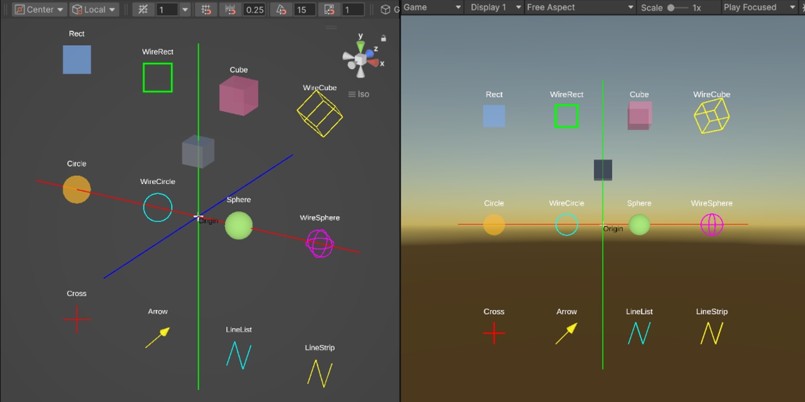

# Unity_RuntimeGizmos



Runtime Gizmos with text rendering support.

## Importing

You can use Package Manager or import it directly.

```
https://github.com/XJINE/Unity_RuntimeGizmos.git?path=Assets/Packages/RuntimeGizmos
```

### Dependencies

This project use following resources.

- Unity.TextMeshPro

## How to Use

### Add TextMeshPro resources

Add TextMeshPro resources to your project, as it references ``TMP_Settings.defaultFontAsset``.

#### Minimum resources

Due to licensing reasons, TextMeshPro resources are not included in this repository.
The following is the minimum set of resources required to use the default TextMeshPro:

```
Resources/TMP Settings.asset
Resources/Fonts & Materials/LiberationSans SDF.asset
Resources/Fonts & Materials/LiberationSans SDF - Fallback.asset
Resources/Style Sheets/Default Style Sheet.asset
Resources/LineBreaking Leading Characters.txt
Resources/LineBreaking Following Characters.txt
Fonts/LiberationSans.ttf
Fonts/LiberationSans - OFL.txt
Shaders/TMP_SDF-Mobile.shader
Shaders/TMPro_Properties.cginc
```

### Implementation

Write ``RuntimeGizmos.Draw~`` calls inside ``OnDrawGizmos``. No other setup is needed.

```csharp
private void OnDrawGizmos()
{
    RuntimeGizmos.Draw~…
}
```

- In the editor, Unity's native gizmo pass calls ``OnDrawGizmos`` as usual (the Gizmos toggle works).
- In builds, IL weaving injects an ``OnDrawGizmos()`` call into ``Update`` at build time.
  See [IL Weaving](#il-weaving) for details.

```csharp
// Classic style
var prevColor = RuntimeGizmos.Color;
RuntimeGizmos.Color = Color.white;
~
RuntimeGizmos.Color = prevColor;

// Block style
RuntimeGizmos.SaveColor();
RuntimeGizmos.Color = Color.white;
RuntimeGizmos.Draw~
RuntimeGizmos.Color = Color.yellow;
RuntimeGizmos.Draw~
RuntimeGizmos.RestoreColor();

// Scope style
using var tempColor = RuntimeGizmos.TempColor(color);
RuntimeGizmos.Draw~
~

using(RuntimeGizmos.TempColor(color))
{
    RuntimeGizmos.Draw~
    ~
}
```

There are three ways to configure the options.

### API

#### Draw Methods

```csharp
DrawText       (Vector3 position, string text, TextAnchor anchor = TextAnchor.MiddleCenter)
DrawTexture    (Vector3 position, Vector2 size, Texture texture)
DrawRect       (Vector3 position, Vector2 size)
DrawWireRect   (Vector3 position, Vector2 size)
DrawCross      (Vector3 position, float size)
DrawLine       (Vector3 from, Vector3 to)
DrawRay        (Vector3 from, Vector3 direction)
DrawRay        (Ray ray)
DrawLineList   (ReadOnlySpan<Vector3> points)
DrawLineStrip  (ReadOnlySpan<Vector3> points, bool looped = false)
DrawArrow      (Vector3 from, Vector3 to, float headSize = 24f, int segments = 12)
DrawCircle     (Vector3 center, float radius, int segments = 32)
DrawWireCircle (Vector3 center, float radius, int segments = 32)
DrawCube       (Vector3 center, Vector3 size)
DrawWireCube   (Vector3 center, Vector3 size)
DrawSphere     (Vector3 center, float radius, int segments = 16)
DrawWireSphere (Vector3 center, float radius, int segments = 32)
DrawFrustum    (Vector3 center, float fov, float maxRange, float minRange = 0f, float aspect = 1f)
```

#### Options

```csharp
LayerName     // Layer name used for per-camera culling mask filtering. Default is "RuntimeGizmos".
OccludedAlpha // Alpha applied to parts hidden behind scene objects. Default is 0.15.
Thickness     // Line thickness in pixels.
FontSize      // Text font size.
MaxDistance   // Max distance from the camera to draw. 0 means no limit.
Color         // Draw color.
Matrix        // Transform applied to drawn positions.
```

### Culling Mask

To control RuntimeGizmos visibility per camera, add a layer named ``RuntimeGizmos`` to your project.
Cameras whose Culling Mask does not include the ``RuntimeGizmos`` layer will skip drawing.

If the layer does not exist, RuntimeGizmos draws on all cameras as before.

## IL Weaving

RuntimeGizmos uses IL weaving (``ILPostProcessor`` + Mono.Cecil) for player builds only.
The editor code is never modified; there, Unity's native gizmo pass does the work.

At build time, every assembly that references RuntimeGizmos is processed.
For each MonoBehaviour whose ``OnDrawGizmos`` uses ``RuntimeGizmos.~``:

- An ``OnDrawGizmos()`` call is injected at the top of its ``Update``.
- If the class has no ``Update``, one is generated.
  The generated ``Update`` calls the inherited ``base.Update()`` first, when one exists.
- ``Update`` methods that already call ``OnDrawGizmos()`` manually are left as they are.

### Limitations

- ``RuntimeGizmos.Draw~`` calls must appear directly inside ``OnDrawGizmos``.
  Classes that draw only through helper methods called from elsewhere are not detected.
- ``OnDrawGizmosSelected()`` is not called in builds.
- ``UnityEngine.Gizmos.~`` calls inside ``OnDrawGizmos`` do nothing in builds.
- Disabled components do not draw in builds (``Update`` is not called),
  while the editor still draws them (native ``OnDrawGizmos`` behavior).
- Hiding a non-virtual ``OnDrawGizmos`` with ``new`` in a derived class is not supported.
  Use ``protected virtual`` / ``override`` instead.
- If a base class in another assembly declares an inaccessible (private / internal) ``Update``
  and the derived class does not declare its own, the build fails with an error message
  that explains the workarounds.
- ``Camera.current`` and other gizmo-pass-only APIs are not available in builds,
  because the call runs in ``Update``.

## Development Notes

Only options that apply to all Gizmos drawn at the same time are provided.
For example, a parameter like ``segments`` should not be provided as an option.

DrawGUITexture and Draw(Wire)Mesh are excluded since alternatives exist.
DrawIcon is also excluded for the same reason as textures.
